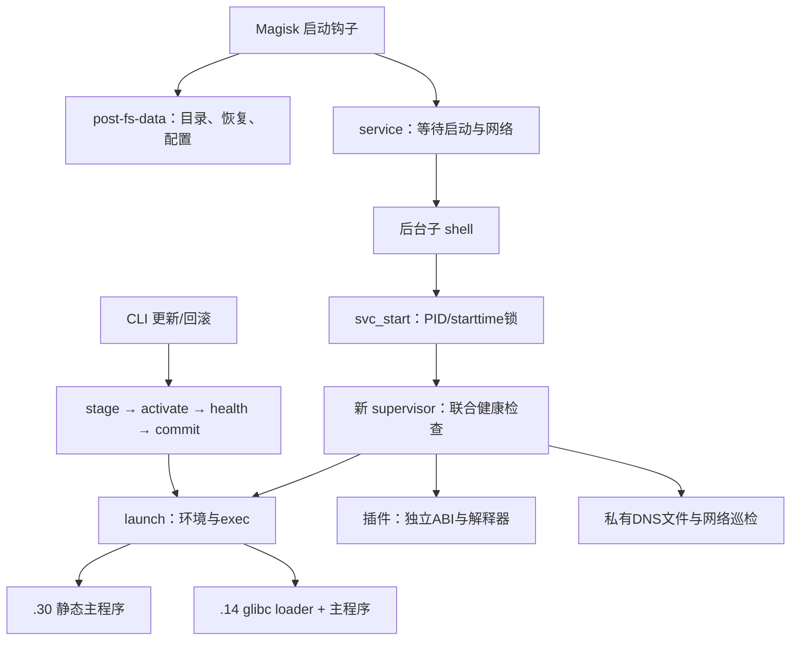

# Agent2API Android 17 Magisk 模块源码与运行机制审计

> 日期：2026-11-03。分析类型：只读源码审计 + 本地隔离复现 + 发布包/ELF检查；flavor=null。

## 1. 结论与修复优先级

根目录交付树实际仍是 magisk.14；同目录发布的 magisk.30 ZIP 来自独立 a2a-build30，二者不能混为一个版本。最新静态主程序减轻了glibc加载依赖，但脚本控制面仍保留旧契约。最优先处理的是默认Magisk冷启动失败、回滚健康失败后丢失当前版本、事务trap及信号清锁后继续执行，之后是插件ABI误改、锁恢复、快速崩溃退避、配置转义。DNS新增阶梯逻辑存在成功判定、策略路由、原子发布与回滚问题。此次没有修改源文件，没有刷机、安装模块或在Android17设备上运行。

严重程度以功能可用性/数据完整性影响排序，并非CVSS评分。`validated`可表示源代码事实或受控控制流已验证；每项均写明是否实际运行函数、是否用stub、设备侧尚缺何种证据，绝不把宿主实验当成完整Android复现。

| 版本 | 位置 | 核实结果 |
|---|---|---|
| 基线 | [module.prop:3-4](<E:/AI/tmp/a2a/module.prop#L3-L4>) | v3.3.0-beta.6 (magisk.14)，versionCode=2026103114，主程序glibc动态ELF |
| 最新比较树 | [module.prop:3-4](<E:/AI/tmp/a2a-build30/module.prop#L3-L4>) | v3.3.0-beta.6 (magisk.30)，versionCode=2026110130，主程序无PT_INTERP/PT_DYNAMIC |
| 实际发布包 | [agent2api-magisk-v3.3.0-beta.6-magisk.30.zip](<E:/AI/tmp/a2a/out/agent2api-magisk-v3.3.0-beta.6-magisk.30.zip>) | 17,461,505字节、880项、CRC通过、与build30逐项SHA一致、无反斜杠项名 |

范围见 [scope.md](<E:/AI/tmp/a2a-review-20261103/scope.md>)；过程见 [timeline.md](<E:/AI/tmp/a2a-review-20261103/timeline.md>)；源码与包哈希见 [source-manifest.json](<E:/AI/tmp/a2a-review-20261103/source-manifest.json>)。首次探测保存的36个脚本哈希与收尾复核差异：0。

| ID | 级别 | 结论 | 证据与验证层 |
|---|---|---|---|
| F-001 | 高 | 启动后台子 shell 的 $$ 指向已退出父进程 | E-001；详见单项边界 |
| F-002 | 高 | 手动回滚在健康验证前删除当前可用版本 | E-004；详见单项边界 |
| F-003 | 中 | 插件修复把 Android bionic ELF 改由 glibc loader 启动 | E-004；详见单项边界 |
| F-004 | 中 | 死锁回收者遗留 reaping 后没有再次回收路径 | E-002；详见单项边界 |
| F-005 | 中 | 短暂健康后的快速崩溃绕过退避和六次熔断 | E-003；详见单项边界 |
| F-006 | 中 | 配置值经 awk -v 解释转义，字面量反斜杠变成新配置行 | E-005；详见单项边界 |
| F-007 | 高 | 服务启停覆盖并清空外层事务信号 trap | E-004；详见单项边界 |
| F-008 | 中 | beta版本比较丢失 major 和预发布数字段 | E-004；详见单项边界 |
| F-009 | 中 | DNS连通性把HTTP500等响应当成成功 | E-005；详见单项边界 |
| F-010 | 中 | IPv6判定只看main表，Android策略路由可被误判 | E-005；详见单项边界 |
| F-011 | 中 | DNS候选写入不原子，失败回滚也不保留完整原文件 | E-005；详见单项边界 |
| F-012 | 中 | host配置与固定IPv4回环健康探测相互冲突 | E-008；详见单项边界 |
| F-013 | 中 | keep_awake在门限暂停与热关闭时没有释放分支 | E-008；详见单项边界 |
| F-014 | 中 | 静态主程序与glibc运行时契约仍混合，自愈和配置语义不一致 | E-006,E-007,E-008,E-011；详见单项边界 |
| F-015 | 低 | 自定义HTTPS镜像前缀配置被忽略 | E-005,E-004；详见单项边界 |
| F-016 | 低 | 异常停止失败时server身份文件已提前删除 | E-008；详见单项边界 |
| F-017 | 高 | 更新信号清理释放锁后，原事务继续执行 | E-004,E-009；详见单项边界 |
| F-018 | 中 | zoneinfo两次rename之间的中断恢复遗漏 | E-004,E-009；详见单项边界 |
| F-019 | 中 | fallback安装器把独立unzip重复拼接 | E-009；详见单项边界 |

## 2. Android运行机制：它实际做了什么

### 启动、存储与挂载

这是root用户态服务包装模块，而不是向系统分区覆盖文件的传统挂载模块。当前树没有system覆盖目录或sepolicy.rule，卸载也明确没有bind mount要撤。模块代码在/data/adb/modules/agent2api；配置、payload、日志、账号数据持久保存在/data/adb/agent2api；/data/a2a提供私有解析配置与插件loader软链。升级模块目录不等于自动迁移所有持久状态。

Magisk post-fs-data在Zygote前阻塞执行，适合短小目录/恢复操作，不应做网络等待。service属于非阻塞late_start，模块额外后台化本身并非必要，却引入$$失配。boot-completed并非Magisk标准钩子，不能用KSU上的成功证明Magisk冷启动可靠。脚本注释里的late_start阻塞和10秒限制不应作为设计依据。



图中service后台子shell→锁是F-001的断点；事务健康验证前commit是F-002的断点。图反映源码调用关系，不表示每个当前实现步骤都已正确完成。

### ELF、libc与16KB页

.14显式loader启动可绕开缺失的/lib/ld-linux-aarch64.so.1；LD_LIBRARY_PATH只对动态加载有效，不能把Android bionic库变成glibc库。.30主服务确为静态ELF，不能再笼统称“主服务必须由glibc loader执行”。包内仍有旧glibc库供插件等使用，且curl经ELF及编译字符串确认为musl静态PIE，不依赖这些glibc库。curl有c-ares/AsynchDNS指纹，但未执行curl -V或追踪活跃后端；它与主程序是独立消费者，DNS/ABI契约应分别核对，不能把curl成功直接等同主程序解析成功。

所有本次记录的包内ELF PT_LOAD均align=65536，offset/vaddr满足16KB同余。故没有证据支持“4KB对齐导致Android17必定启动失败”。静态对齐通过也不等于所有内存映射、插件、系统调用、SELinux运行行为已在16KB设备验收。

.30主程序已经包含/data/a2a/resolv而非默认/etc/resolv.conf，不能报告成“静态程序根本不读模块DNS文件”。但glibc的nsswitch/gai/no-aaaa等配置语义不可仅凭同一个resolv路径推广给musl。静态字符串没有某选项只作线索，精确行为需对应构建源码或函数级反编译/设备解析测试。

### SELinux、命名空间、cgroup和Doze

root UID不等于所有SELinux权限。模块没有新增策略本身不是已证实故障：应看服务实际scontext、目标标签、AVC与root管理器策略。显式glibc loader主要受内核文件访问/执行和自身依赖搜索控制，Android bionic linker namespace不能替代其ABI。当前不使用chroot/unshare，减少挂载清理问题，但不能由此推断插件能穿过所有Android策略。

cgroup_escape只检查固定根路径和/proc/self/cgroup首行，覆盖不了所有Android cgroup v1/v2及task profile组合；是否实际受限要采集/proc/PID/cgroup和控制器。oom_score_adj仅部分进程调整不能证明supervisor不会被lmkd/OOM终止。keep_awake是内核节点写入，不等价framework Doze网络白名单；未做白名单也不足以证明root服务一定断网。此类项目列为真机验收，而非凭缺少命令硬报漏洞。

## 3. 详细发现

### F-001 启动后台子 shell 的 $$ 指向已退出父进程
- severity: high
- category: design
- status: validated
- evidence_ids: [E-001]
- location: [service.sh:36-67](<E:/AI/tmp/a2a-build30/service.sh#L36-L67>)；[libexec/payload.sh:46-61](<E:/AI/tmp/a2a-build30/libexec/payload.sh#L46-L61>)
- confidence: high
- 版本与条件: 两版 .14/.30；默认 Magisk 冷启动路径
- impact: service.sh 用 `( ... svc_start ) &` 后父脚本退出。子 shell 的 $$ 保持父 PID；默认等待启动完成及 boot_delay=8 后，proc_start_ticks $$ 读取已消失进程，update_lock_acquire 直接返回 1，svc_start_impl 没有执行。KSU/APatch 的前台 boot-completed 钩子可能掩盖，Magisk 没有这个钩子。
- 观察与复现: 真实锁函数隔离复现：后台 $$ 保留父进程号，BASHPID 为真实子进程号；父 /proc 已消失、真实子 ticks 可读，两版均 update_lock_acquire_rc=1。具体PID见原始记录。此为 shell 语义与本地复现，尚未录制设备冷启动日志。
- remediation: 将延迟与准备步骤移入真正的新 shell helper，以 `setsid sh helper &` 或 `sh helper &` 启动，让锁 owner 的 PID/starttime 属于执行者；不要使用 Linux Bash 专有 BASHPID 修补 Android sh。Magisk 的 late_start 本来非阻塞，也可在 service hook 当前 shell 内顺序完成。
- 回归验收: 父 hook 返回后才尝试锁；断言 supervisor 启动、锁 owner 对应活进程、重复 hook 不重复启动。
- optional_attack: n/a；本审计为本地模块可靠性/边界审查，不归因为已发生攻击。

### F-002 手动回滚在健康验证前删除当前可用版本
- severity: high
- category: design
- status: validated
- evidence_ids: [E-004]
- location: [libexec/payload.sh:198-226](<E:/AI/tmp/a2a-build30/libexec/payload.sh#L198-L226>)；[libexec/a2a:319-350](<E:/AI/tmp/a2a-build30/libexec/a2a#L319-L350>)
- confidence: high
- 版本与条件: 两版相同提前删除逻辑；.30 用真实函数隔离实测
- impact: payload_activate_staged 在结构校验后 rm -rf 事务旧目录，cmd_rollback 之后才重启并检查健康。rollback_finish 虽想恢复 _rb_old，但该目录已经删除；对失败版本的 payload_validate 仅看结构，无法恢复先前可用版本。
- 观察与复现: 受控工作目录：before=CURRENT-WORKING；回滚到 PREVIOUS-UNHEALTHY；模拟健康失败；rollback-rc=1；after 仍为 PREVIOUS-UNHEALTHY；事务旧目录已消失。该测试验证真实事务控制流，以 stub 代替 Android 服务。
- remediation: 把事务分为 prepare/activate/health/commit：保留本次 old 直到服务健康后再删除；失败先停失败实例，再原子恢复同事务 old，并恢复运行状态。手动 rollback 与 update 共用事务 API，但健康成功前禁止 commit。
- 回归验收: 分别注入启动失败、健康超时、TERM、磁盘满；每次失败后应恢复原版本和原运行状态，old 只能在成功提交后清理。
- optional_attack: n/a；本审计为本地模块可靠性/边界审查，不归因为已发生攻击。

### F-003 插件修复把 Android bionic ELF 改由 glibc loader 启动
- severity: medium
- category: design
- status: validated
- evidence_ids: [E-004]
- location: [libexec/plugin.sh:69-106](<E:/AI/tmp/a2a-build30/libexec/plugin.sh#L69-L106>)
- confidence: high
- 版本与条件: 两版规则存在；.30 用合成 AArch64 ELF 实测改写
- impact: interp_fix 的白名单包含 /system/lib* 和 /apex/*，因此把原本正确的 Android linker64 路径也改为 /data/a2a/ld.so。修改 PT_INTERP 只改变加载器路径，不会把 bionic ABI、DT_NEEDED libc.so、Android namespace 变成 glibc ABI。默认 plugin_interp=1 且扫描到此类插件时可破坏可用文件。
- 观察与复现: 合成 ELF：before=/apex/com.android.runtime/bin/linker64；patch=fixed；after=/data/a2a/ld.so。实测证明错误改写行为；未执行该 AArch64 合成程序。失败范围取决于实际插件 ABI，不能称所有插件都会坏。
- remediation: 只接受明确受支持的 glibc interpreter 路径；保留 /system/bin/linker64、/apex/com.android.runtime/bin/linker64 等 Android loader。结合 ELFCLASS、endianness、e_machine、PT_INTERP、DT_NEEDED 分类，未知 ABI 跳过并报告。不要把动态 musl 简单当作 glibc。
- 回归验收: 准备 glibc 动态、bionic 动态、musl 动态、纯静态四类真实插件；仅 glibc 类允许修复，其他类字节不变。
- optional_attack: n/a；本审计为本地模块可靠性/边界审查，不归因为已发生攻击。

### F-004 死锁回收者遗留 reaping 后没有再次回收路径
- severity: medium
- category: design
- status: validated
- evidence_ids: [E-002]
- location: [libexec/payload.sh:73-103](<E:/AI/tmp/a2a-build30/libexec/payload.sh#L73-L103>)
- confidence: high
- 版本与条件: 两版 .14/.30；特定崩溃窗口
- impact: 旧 owner 已失效时，回收者以硬链接取得 reaping；若在删除 owner 前遭 SIGKILL/OOM，留下 dead owner+dead reaping。后续竞争者只对 reaping 存在重试，没有验证死回收者代次并清理，运行期持续阻塞 start/stop/install/update。开机 post-fs-data 清锁可恢复，非跨重启永久。
- 观察与复现: 基线 stale owner 无 reaping 时 rc=0；加入 dead reaping 后两版 rc=1，owner/reaping 均原样保留。
- remediation: reaping 同样记录 PID+starttime+token 并实现代次验证的死亡回收，或采用可验证可用的随进程退出释放的内核锁。不能按超时盲删活跃锁。
- 回归验收: 在 reaping 发布后、owner 删除前定点杀回收者；下一次调用应安全恢复；同时压力测试多并发活跃者。
- optional_attack: n/a；本审计为本地模块可靠性/边界审查，不归因为已发生攻击。

### F-005 短暂健康后的快速崩溃绕过退避和六次熔断
- severity: medium
- category: design
- status: validated
- evidence_ids: [E-003]
- location: [libexec/supervise.sh:440-505](<E:/AI/tmp/a2a-build30/libexec/supervise.sh#L440-L505>)
- confidence: high
- 版本与条件: 两版 .14/.30；健康首检通过后不足60秒退出
- impact: 死亡分支对不足60秒存活 FAILS++，但新实例首次健康通过后立即 FAILS=0。每次先健康、10秒后崩溃时计数永远 1→0，达不到3次退避/6次熔断，反复初始化消耗资源。启动40秒内从未健康的失败仍能累计，须与本缺陷区分。
- 观察与复现: 从两版源码提取真实循环尾部，外部操作受控 stub，连续8轮均 fails_before_success=1，final_fails=0 final_giveup=0，没有退避输出。
- remediation: 首次健康只标记 started；持续健康运行至少60秒（或配置稳定窗口）后再清 FAILS。计数器按短期失败窗口或同版本代次管理。
- 回归验收: 从未健康、健康后10秒崩溃、健康运行超过60秒三组测试；第二组应触发退避与熔断。
- optional_attack: n/a；本审计为本地模块可靠性/边界审查，不归因为已发生攻击。

### F-006 配置值经 awk -v 解释转义，字面量反斜杠变成新配置行
- severity: medium
- category: design
- status: validated
- evidence_ids: [E-005]
- location: [libexec/common.sh:161-177](<E:/AI/tmp/a2a-build30/libexec/common.sh#L161-L177>)
- confidence: high
- 版本与条件: 两版同实现；.30 实测
- impact: cfg_set 通过 awk -v v="$2" 传原始值，awk 对反斜杠转义再解释。字面量 abc\nallow_no_key=1 被写成两行。合法带反斜杠密码/密钥会变值；若配置写入方可控，可越过预期的单键边界。调用 CLI 本身已需要本机高权限，本报告不把它包装为普通 App 无权限提权。
- 观察与复现: parent_checks.json 的 cfg_backslash_roundtrip 输出实际含 gateway_key=abc 换行 allow_no_key=1。
- remediation: 值经环境变量传给 awk 的 ENVIRON，或采用不二次解释的数据通道；拒绝真实 LF/CR，明确序列化规范。增加配置字段白名单与长度/类型校验，保留600权限和原子替换。
- 回归验收: 往返测试反斜杠n、反斜杠t、双反斜杠、引号、#、&、Unicode；值应逐字一致，拒绝多行。
- optional_attack: n/a；本审计为本地模块可靠性/边界审查，不归因为已发生攻击。

### F-007 服务启停覆盖并清空外层事务信号 trap
- severity: high
- category: design
- status: validated
- evidence_ids: [E-004]
- location: [libexec/control.sh:125-136](<E:/AI/tmp/a2a-build30/libexec/control.sh#L125-L136>)；[libexec/control.sh:204-215](<E:/AI/tmp/a2a-build30/libexec/control.sh#L204-L215>)
- confidence: high
- 版本与条件: 两版结构；.30 实测
- impact: svc_start/stop 在调用者 shell 中安装 trap exit130，返回时 trap - HUP INT TERM，而不是恢复已有处理器。updater/rollback 的恢复 trap 因此被覆盖；服务启停期间和之后收到信号可能跳过外层事务恢复/释放路径。
- 观察与复现: 先设 TERM echo outer-recovery；真实 svc_start/stop 用 stub 隔离后，trap -p TERM 均为空。
- remediation: 服务锁逻辑放入独立新 shell 或显式保存并恢复调用者 traps；失败分支也须恢复；统一由外层事务拥有最终信号清理，不在底层随意清除。
- 回归验收: 在stop/start前、中、后注入TERM并验证旧payload恢复、锁释放、无新旧服务并存；不能只验证函数正常返回。
- optional_attack: n/a；本审计为本地模块可靠性/边界审查，不归因为已发生攻击。

### F-008 beta版本比较丢失 major 和预发布数字段
- severity: medium
- category: design
- status: validated
- evidence_ids: [E-004]
- location: [libexec/updater.sh:98-124](<E:/AI/tmp/a2a-build30/libexec/updater.sh#L98-L124>)
- confidence: high
- 版本与条件: 两版存在同类比较逻辑；.30 实测
- impact: 比较器把含v的首段直接 +0，major 都成为0；又未完整保留 beta.10 的数字段。beta选择可能错过新主版本，或把beta.6排在beta.10前，导致更新选择回退/停滞。
- 观察与复现: v3.3.0-beta.6 / v3.4.0-beta.10 / v4.0.0-beta.2 的结果为 v3.4.0-beta.10；同版本 beta.6 与 beta.10 选择 beta.6。
- remediation: 先移除单个v，再按SemVer完整比较 major/minor/patch、预发布标识序列；数值标识做数值比较，稳定版优先于同版本预发布。对无法解析tag显式跳过。
- 回归验收: 覆盖v4.0.0大于v3.99.99、beta.10大于beta.6、正式版大于同版本beta、构建元数据忽略等表驱动测试。
- optional_attack: n/a；本审计为本地模块可靠性/边界审查，不归因为已发生攻击。

### F-009 DNS连通性把HTTP500等响应当成成功
- severity: medium
- category: design
- status: validated
- evidence_ids: [E-005]
- location: [libexec/dns.sh:416-424](<E:/AI/tmp/a2a-build30/libexec/dns.sh#L416-L424>)
- confidence: high
- 版本与条件: 新增DNS阶梯逻辑，主要 .30
- impact: curl 只检查传输退出码，未用 -f 或验证预期204。HTTP500/404/门户页面都可当成功，错误候选写入 lastgood，失效解析器/门户仍被标记可用。即使204成功也只证明一个目标的DNS+HTTP路径，不能等同上游服务域名全部可达。
- 观察与复现: 本地受控HTTP服务器返回500；实际 dns_liveness_ok 输出 http_status=500 dns_liveness_rc=0。
- remediation: 明确探测契约：使用 -f 并核对204（或指定预期码/内容）；分别记录DNS失败、TCP失败、HTTP状态；测试不应因工具缺失就伪称已验证。
- 回归验收: 模拟500、302、200门户、204、解析超时；仅契约匹配时更新 lastgood；探测结果需带所用解析器和候选标识。
- optional_attack: n/a；本审计为本地模块可靠性/边界审查，不归因为已发生攻击。

### F-010 IPv6判定只看main表，Android策略路由可被误判
- severity: medium
- category: design
- status: validated
- evidence_ids: [E-005]
- location: [libexec/dns.sh:437-461](<E:/AI/tmp/a2a-build30/libexec/dns.sh#L437-L461>)
- confidence: high
- 版本与条件: 主要 .30；策略路由场景；对静态musl选项效果另见架构章节
- impact: dns_ipv6_usable 先要求 ip -6 route show default 有输出；Android默认路由常在每网络表。即使 route get/表1010有可用IPv6，main为空也直接返回1，跳过后续探测，缓存no-aaaa倾向3小时。对保留的glibc组件可抑制AAAA；对静态musl主程序不可直接推断同样生效。
- 观察与复现: mock ip：main无default，table1010有default；真实函数 usable_rc=1。只证明路由判定逻辑，不是实际Android网络抓包。
- remediation: 以该进程实际 ip -6 route get 为主要依据，结合 rule/table和真实请求；按netId/网络代次缓存，切网立即失效；resolver能力矩阵决定是否输出no-aaaa。
- 回归验收: 真机IPv6-only/NAT64、双栈、VPN分流；main为空但进程IPv6请求成功时不得标记全局无IPv6。
- optional_attack: n/a；本审计为本地模块可靠性/边界审查，不归因为已发生攻击。

### F-011 DNS候选写入不原子，失败回滚也不保留完整原文件
- severity: medium
- category: design
- status: validated
- evidence_ids: [E-005]
- location: [libexec/dns.sh:476-541](<E:/AI/tmp/a2a-build30/libexec/dns.sh#L476-L541>)
- confidence: high
- 版本与条件: 主要 .30
- impact: dns_apply_list 用 cp -f 直接覆盖正在使用的DNSFILE，读者可能见到空/半文件。dns_ensure 原始快照只保存nameserver；全部候选失败后重建文件，原search与options丢失，部分缓存可能与实际状态不一致。非原子风险来自控制流；内容丢失已实测。
- 观察与复现: 原文件含 search corp.example、options ndots:5 timeout:9；模拟候选全部失败后 ensure_rc=1，但search消失、options变timeout:2 attempts:2。
- remediation: 同目录临时文件完整生成、校验、chmod后rename；完整备份原字节和对应cache，失败一并恢复。候选探测与正式发布分离，避免未验证候选先影响所有读者。
- 回归验收: 解析器并发持续读取时反复切换，确保每次均完整；失败后cmp原文件与缓存；断电/进程杀死后保留上一版完整文件。
- optional_attack: n/a；本审计为本地模块可靠性/边界审查，不归因为已发生攻击。

### F-012 host配置与固定IPv4回环健康探测相互冲突
- severity: medium
- category: design
- status: validated
- evidence_ids: [E-008]
- location: [libexec/launch.sh:41-79](<E:/AI/tmp/a2a-build30/libexec/launch.sh#L41-L79>)；[libexec/control.sh:49-65](<E:/AI/tmp/a2a-build30/libexec/control.sh#L49-L65>)
- confidence: high
- 版本与条件: 两版；非默认指定LAN/IPv6监听地址
- impact: 启动器传透host，但health永远访问127.0.0.1。绑定具体LAN地址或上游支持的IPv6-only地址时，服务在正确接口监听仍会健康失败，被40秒启动检查终止或后续重启。默认127.0.0.1及IPv4 wildcard不受此特定问题影响。
- 观察与复现: 源码数据流已确认；设备侧监听和IPv6host参数接受形式未执行。validated指配置/检查目标不一致的代码事实。
- remediation: 根据bind地址选择可达的本机探测地址：0.0.0.0映射127.0.0.1，::按IPv6能力选择::1，具体地址原样且IPv6加[]；同时禁用health的环境代理影响。
- 回归验收: 绑定127、0.0.0.0、特定LAN和::1四组；核对PID/socket/HTTP联合验证不放松。
- optional_attack: n/a；本审计为本地模块可靠性/边界审查，不归因为已发生攻击。

### F-013 keep_awake在门限暂停与热关闭时没有释放分支
- severity: medium
- category: design
- status: validated
- evidence_ids: [E-008]
- location: [libexec/supervise.sh:286-294](<E:/AI/tmp/a2a-build30/libexec/supervise.sh#L286-L294>)；[libexec/supervise.sh:330-435](<E:/AI/tmp/a2a-build30/libexec/supervise.sh#L330-L435>)
- confidence: high
- 版本与条件: 两版；keep_awake=1且设备有可写wake_lock节点
- impact: 只有cleanup释放锁；主循环在keep_awake=1时take，改0或电量门限暂停不会release。服务已停止但supervisor仍持无限时agent2api唤醒锁，违背省电门限意图。默认keep_awake=0、没有相关内核节点时不适用。
- 观察与复现: 源码所有take/release调用已核对；未在Android17内核采集wakeup_sources。
- remediation: 每轮协调desired_wake = healthy_or_starting && keep_awake，paused/dead/disabled/关闭开关时释放；记录当前持有状态防重复写。
- 回归验收: 真机低电量暂停、WiFi断开、热关keep_awake、stop及异常退出后，检查锁均释放；Doze网络行为单独测试。
- optional_attack: n/a；本审计为本地模块可靠性/边界审查，不归因为已发生攻击。

### F-014 静态主程序与glibc运行时契约仍混合，自愈和配置语义不一致
- severity: medium
- category: design
- status: validated
- evidence_ids: [E-006,E-007,E-008,E-011]
- location: [libexec/launch.sh:25-31](<E:/AI/tmp/a2a-build30/libexec/launch.sh#L25-L31>)；[libexec/payload.sh:296-298](<E:/AI/tmp/a2a-build30/libexec/payload.sh#L296-L298>)；[libexec/common.sh:624-671](<E:/AI/tmp/a2a-build30/libexec/common.sh#L624-L671>)
- confidence: high
- 版本与条件: .30；当前包带完整库，非首次安装必失败
- impact: 静态lib_verify直接成功，但launch在判静态前仍硬要求loader可执行；loader损坏/删除时无法靠静态主程序继续启动，且不会触发lib_restore。安装/恢复仍要求libc/loader；静态判定用grep字符串而非PT_INTERP。生成nss/gai/no-aaaa等glibc配置也不等于静态musl主程序一定使用。
- 观察与复现: ELF证据：.30主程序无PT_INTERP/无PT_DYNAMIC；当前包保留完整glibc库。主程序有/data/a2a/resolv，但nsswitch/gai.conf/no-aaaa字符串未见；后者只是辅助线索，不是完整执行证明。
- remediation: 引入payload ABI能力元数据并由ELF验证：static/dynamic-glibc/dynamic-musl/bionic；主服务、curl、插件分开定义依赖与DNS能力。静态主服务分支跳过不需要的loader硬检查，保留插件运行时独立自愈。update_asset按架构/ABI选择，防静态种子更新回动态时契约漂移。
- 回归验收: 静态server+缺loader应按设计独立启动；动态server+坏loader应自愈；错误ABI更新包拒绝；DNS选项按实际libc单独回归。
- optional_attack: n/a；本审计为本地模块可靠性/边界审查，不归因为已发生攻击。

### F-015 自定义HTTPS镜像前缀配置被忽略
- severity: low
- category: design
- status: validated
- evidence_ids: [E-005,E-004]
- location: [libexec/updater.sh:19-28](<E:/AI/tmp/a2a-build30/libexec/updater.sh#L19-L28>)
- confidence: high
- 版本与条件: 两版；配置自定义https前缀
- impact: mirror_url按cfg分支选到https后却输出$1与${2#https://}；实际调用只传一个URL，$1是原始GitHub地址，$2为空，配置前缀未使用。内建镜像标签和自定义前缀行为不一致。
- 观察与复现: 设置https://mirror.example/后，返回原始https://github.com/...，两个独立测试一致。
- remediation: 保存配置前缀到命名变量，明确前缀与原URL的拼接契约和尾斜杠；校验https scheme且测试tar与sha两条调用路径。
- 回归验收: 自定义前缀、内建标签、关闭镜像三组断言最终URL；官方sha直连与受信pin规则保持。
- optional_attack: n/a；本审计为本地模块可靠性/边界审查，不归因为已发生攻击。

### F-016 异常停止失败时server身份文件已提前删除
- severity: low
- category: design
- status: validated
- evidence_ids: [E-008]
- location: [libexec/supervise.sh:196-232](<E:/AI/tmp/a2a-build30/libexec/supervise.sh#L196-L232>)；[libexec/supervise.sh:286-305](<E:/AI/tmp/a2a-build30/libexec/supervise.sh#L286-L305>)
- confidence: high
- 版本与条件: 两版；TERM/KILL后进程仍存活的异常条件
- impact: stop_child开头删除server.pid/start，若进程不可及时终止则return1；cleanup也提前返回并声称保留身份，但文件已丢。外部控制读取不到server PID，后续可能出现停止状态与残留端口不一致。需要不可中断内核等待或同类异常，未设备复现。
- 观察与复现: 源码删除顺序和异常分支确定；没有声称SIGKILL可被普通用户态进程忽略。
- remediation: 确认目标退出且starttime匹配后才删除身份；停止失败保留PID/start及失败原因，返回失败且不启动新实例。
- 回归验收: 以可控stub模拟kill后仍alive，断言身份文件保留；正常退出则清理；不要在真机制造不可恢复内核等待。
- optional_attack: n/a；本审计为本地模块可靠性/边界审查，不归因为已发生攻击。

### F-017 更新信号清理释放锁后，原事务继续执行
- severity: high
- category: design
- status: validated
- evidence_ids: [E-004,E-009]
- location: [libexec/updater.sh:275-305](<E:/AI/tmp/a2a-build30/libexec/updater.sh#L275-L305>)
- confidence: high
- 版本与条件: 两版；.30 信号夹具实测，.14 对应216–229/246行
- impact: upd_on_signal 调用恢复/清理后只 return 1；trap 没有 exit。UPD_ABORT 仅赋值而无消费检查，因此处理信号后会继续被中断位置后面的事务代码。锁已释放时其他更新可进入，原流程仍可能写入/rename，独立于F-007的trap覆盖问题。
- 观察与复现: 真实处理器注册TERM trap并对夹具自身发送TERM：cleanup=1，之后仍输出 continued-after-signal UPD_ABORT=1，最终rc0。事务恢复外部动作作明确stub，只证明信号控制流继续，不声称已在设备制造双写。
- remediation: 将普通失败清理与终止信号入口分开；信号处理器清理后exit对应的128+signal状态，禁止清锁后继续。统一顶层事务持有trap；与F-007一起修复。
- 回归验收: 在下载、激活前后、健康验收前后注入TERM/HUP/INT；每次终止后都无后续写入，锁只在停止事务后释放，原工作版本可恢复。
- optional_attack: n/a；本审计为本地模块可靠性/边界审查，不归因为已发生攻击。

### F-018 zoneinfo两次rename之间的中断恢复遗漏
- severity: medium
- category: design
- status: validated
- evidence_ids: [E-004,E-009]
- location: [customize.sh:121-133](<E:/AI/tmp/a2a-build30/customize.sh#L121-L133>)；[customize.sh:244-254](<E:/AI/tmp/a2a-build30/customize.sh#L244-L254>)
- confidence: high
- 版本与条件: 两版；.30 实测清理阶段，.14 对应118–130/241–251行
- impact: 旧zoneinfo已经移走但新目录尚未落位时，_ZONE_OLD_PRESENT=1而_ZONE_COMMITTED=0。install_cleanup只在后一个标记为1时恢复旧目录，信号/退出会留下缺失的正式zoneinfo路径。时区逻辑有降级，不等同主服务必停。
- 观察与复现: 真实install_cleanup夹具输出 zone-live-exists=1、zone-old-exists=0；这些值是test -d返回码，分别代表正式目录缺失、旧目录仍存在。
- remediation: 以旧目录已移走作为恢复条件；使用明确阶段状态机/journal覆盖每个rename窗口。tools、zoneinfo和payload共享可恢复事务，验收成功才删除旧数据。
- 回归验收: 对每次rename前后逐点注入中断，失败后正式路径必须存在且内容为原版；成功后才允许清理备份。
- optional_attack: n/a；本审计为本地模块可靠性/边界审查，不归因为已发生攻击。

### F-019 fallback安装器把独立unzip重复拼接
- severity: medium
- category: design
- status: validated
- evidence_ids: [E-009]
- location: [META-INF/com/google/android/update-binary:72-82](<E:/AI/tmp/a2a-build30/META-INF/com/google/android/update-binary#L72-L82>)
- confidence: high
- 版本与条件: 两版相同；仅fallback路径且存在独立unzip时触发
- impact: 独立unzip分支与busybox分支都设置UNZIP="$u unzip"，随后$UNZIP -o执行为unzip unzip -o ZIP。第二个unzip被当作包名，导致兜底安装失败；标准管理器install_module成功路径不受此问题影响。
- 观察与复现: 直接核对源表达式、分支选择和最终argv，未执行设备安装器。现有发布包完整不代表fallback分支可运行。
- remediation: 独立程序分支仅使用unzip，busybox分支才添加unzip子命令；用函数封装命令向量而非混合含空格字符串。
- 回归验收: 以受控stub记录独立unzip与busybox两条argv；分别断言unzip -o ZIP与busybox unzip -o ZIP；另验证install_module失败不会重跑fallback。
- optional_attack: n/a；本审计为本地模块可靠性/边界审查，不归因为已发生攻击。

## 4. 其他改进与已排除疑点

### 可直接安排的改进

- 更新包类型白名单：当前tar清单检查挡住链接与路径穿越，却接受设备节点（合成tar的upd_tar_safe rc=0，未实际解包）。root解包器应仅允许常规文件/目录、拒绝设备/FIFO/socket等；设置文件数、解压字节数和单文件上限；常见./前缀是否支持要显式定义。此为包处理加固，不代表无需控制受信发布源就能攻击设备。
- DNS网络身份：不要仅靠tun设备“存在”推断该root进程实际走VPN；Android的UID规则、fwmark、netId、分流及VPN允许/排除名单都影响实际路径。用该进程的实际出站结果验证，避免公共DNS绕过企业分域策略。
- WiFi门限：固定wlan0/wlan1/swlan0的IPv4地址检查会遗漏IPv6-only和厂商命名；按活动网络/路由与接口类型识别，回归热点与仅WiFi无IPv4场景。
- 开销与写放大：健康循环每30秒有两次HTTP检查、6次5秒sleep；维护还含多次shell/awk/grep与状态/描述写入。先把健康结果复用、状态变化时才写JSON/模块描述，再按设备profile测量CPU/唤醒次数。不要为了“秒级热重载”每轮重复写磁盘。
- privacy_shield只处理已存在debug目录，周期性软链不能证明所有请求数据永不落盘；若上游原子rename会替换软链，保护亦会失效。优先在匹配构建的应用端禁用debug落盘，再验证创建/替换行为。没有匹配上游执行证据前不硬报泄露。
- WebUI把状态版本等拼进innerHTML：改textContent/DOM节点并做JSON序列化。当前可控字段主要来自本地受信payload，未证明普通远程攻击者可触达；不夸大成远程XSS链。纯Magisk本身也不自动提供KSU WebUI宿主。
- 配置热重载分层：host/port/key等启动环境修改应明确要求受控重启；门限/日志等可热生效。当前健康探测立即重读端口而服务仍监听旧端口，会导致间接重启，不能充当干净的配置事务。
- 卸载并发：uninstall忽略svc_stop失败，且未取得顶层更新锁就删除锁/tmp/live；应统一生命周期锁并等待停止确认。本次仅确认源码缺口，未模拟完整并发卸载链。
- Windows重建可复现性：pack30.py:32的replace匹配两个反斜杠，原生Windows单反斜杠路径传入mode_for会错过嵌套可执行文件，分配644；ZipInfo自行标准化项名。当前ZIP权限实测正确，故这是构建脚本缺口而非当前包损坏；未运行会覆盖项目的packer。
- settings/schema与版本标识：根目录.14和out/.30混放容易让审查/维护人员改错源树。固定唯一构建入口、release manifest、ABI/patch级版本、源码快照SHA，并避免历史补丁和旧报告被误当当前现实。

### 已核实不成立或不能直接成立的说法

1. .30 ZIP路径反斜杠错误：实际880项无反斜杠且逐项匹配build30，排除。
2. .30主程序是假静态或仍有PT_INTERP：ELF头证据否定，排除。
3. 所有ELF只有4KB对齐：实际64KB段对齐、16KB同余，排除。
4. 静态主程序没有模块DNS路径：/data/a2a/resolv已存在，排除；选项兼容性另行验证。
5. 最新完全不识别静态server PID：control已补绝对argv匹配，排除旧版推断。
6. 最新net_ready只查main路由：该函数已加route-get/IPv6/all表；问题仍在另一独立函数dns_ipv6_usable，不混淆。
7. 任意外部服务占同端口就被认为健康：代码还校验PID身份、socket归属、HTTP200和status体，排除。
8. /proc/stat starttime字段差两位：去掉comm后读第20字段即原第22字段，正确。
9. awk END必然覆盖路径穿越拒绝：真实tar用例../与./都rc1，排除该早期假设。
10. 无sepolicy.rule、无Doze白名单、无系统挂载，所以Android17必失败：证据不足，留真机矩阵，不作已复现结论。

## 5. 修复实施顺序与验收矩阵

先修F-001启动身份；随后统一F-002/F-007/F-017的事务提交、trap所有权与信号终止，再收紧F-003插件ABI；接着修锁回收与快速崩溃；最后按resolver ABI收敛DNS与静态迁移。每组独立回归，避免大改后无法确定归因。此次仅给修复设计，未对源码应用补丁。

| 维度 | 最小用例 | 验收标准 |
|---|---|---|
| root管理器 | Magisk冷启动/重启；KSU/APatch独立钩子 | 只有一个supervisor；每个owner PID/starttime匹配；无需手动start |
| Android17内核 | arm64 4KB/16KB设备 | 实际exec成功；所有插件按ABI执行；无相关AVC |
| 存储/安装 | 首装、原地升级、空间不足、激活窗口TERM/强杀 | 原版本或新版本完整可启动；配置/账号不丢；无嵌套payload |
| 事务 | 更新成功/健康失败；手动rollback目标失败 | 原可用版本可恢复；保留正确运行/停止状态；成功前不删除old |
| 并发锁 | 两个CLI与安装竞争；reaper被杀 | 最多一个活跃事务；死owner/reaper可自愈，无活锁 |
| 守护 | 从未健康；健康10秒崩溃；稳定60秒 | 快速失败累计、退避/熔断正确，稳定后才清零 |
| 网络 | WiFi/蜂窝/VPN切换；IPv6-only/NAT64；私有DNS | 进程实际路由与探测一致，不误禁AAAA；切网缓存失效 |
| DNS文件 | 并发读取；全部候选失败；进程中断 | 任意时刻文件完整；失败后原字节及缓存一致 |
| 地址与权限 | 默认loopback、具体LAN、IPv6；SELinux enforcing | 联合健康检查一致；不因地址合法变化误杀；最小必要权限 |
| 电源 | 熄屏/Doze/低电量暂停/keep_awake热关闭 | 锁按状态释放；耗电和网络恢复可测；不把sysfs锁等同Doze |
| 生命周期 | disable/remove/uninstall/重新安装 | 无残留服务/锁；保留数据策略符合配置；删除目标限定固定目录 |

设备侧应至少保存：getprop版本/API、getconf PAGE_SIZE、uname、getenforce、ps -AZ、/proc/PID/{status,cgroup,maps,mountinfo}、/proc/PID/attr/current、ip rule、ip route show table all、ip -6 route show table all、模块日志和相关AVC。不要把宿主bash -n通过当作BusyBox ash行为验收。

## 6. 可复现检查与工具覆盖

主要脚本：[parent_checks.py](<E:/AI/tmp/a2a-review-20261103/parent_checks.py>)、[startup-lock-check.sh](<E:/AI/tmp/a2a-review-20261103/startup-lock-check.sh>)、[lock-reaping-check.sh](<E:/AI/tmp/a2a-review-20261103/lock-reaping-check.sh>)、[supervisor-fast-crash-check.py](<E:/AI/tmp/a2a-review-20261103/supervisor-fast-crash-check.py>)、[subagent_verify.py](<E:/AI/tmp/a2a-review-20261103/subagent_verify.py>)、[subagent_probe.py](<E:/AI/tmp/a2a-review-20261103/subagent_probe.py>)。它们依赖本机源码绝对路径与Bash/Python环境，测试仅写review目录；迁移复现需同步修改路径，不要在设备直接source整份安装脚本。

```powershell
& 'C:/Users/Y-H/AppData/Local/Programs/Python/Python312/python.exe' 'E:/AI/tmp/a2a-review-20261103/parent_checks.py'
& 'C:/Users/Y-H/AppData/Local/Programs/Python/Python312/python.exe' 'E:/AI/tmp/a2a-review-20261103/subagent_verify.py'
& 'C:/Users/Y-H/AppData/Local/Programs/Python/Python312/python.exe' 'E:/AI/tmp/a2a-review-20261103/supervisor-fast-crash-check.py'
```

工具覆盖：Python3.12.10标准库、宿主Bash语法检查与函数隔离、ELF结构解析、ZIP CRC/逐项SHA。Semgrep已找到安装，但启动返回 `Fatal error: exception Failure: ca_certs_iter_on_anchors: CertOpenSystemStore returned NULL`（exit2）；未取得Semgrep扫描结果。未找到ShellCheck。网页搜索服务失败后改读可访问官方文档，未以旧报告代替当前源码。REA不用于普通shell仓库架构审查；分审对ELF调用REA布局工具，返回capability_unavailable/unsupported_provider（仅Linux x64）后使用rabin2 6.2.4和结构化ELF解析；未做完整服务端反编译。

## 7. Evidence → Finding → Path

| Evidence | 内容与原始资料 |
|---|---|
| E-001 | 后台启动真实锁函数复现；[result.txt](<E:/AI/tmp/a2a-review-20261103/startup-lock-check/result.txt>)；固定哈希见[E-001.md](<E:/AI/tmp/a2a-review-20261103/evidence/E-001.md>) |
| E-002 | 死回收锁与基线对照；[lock-reaping-check-output.txt](<E:/AI/tmp/a2a-review-20261103/lock-reaping-check-output.txt>)；固定哈希见[E-002.md](<E:/AI/tmp/a2a-review-20261103/evidence/E-002.md>) |
| E-003 | 两版真实循环尾部快速崩溃实验；[a2a-build30-fast-crash-output.txt](<E:/AI/tmp/a2a-review-20261103/a2a-build30-fast-crash-output.txt>)；固定哈希见[E-003.md](<E:/AI/tmp/a2a-review-20261103/evidence/E-003.md>) |
| E-004 | 安装/更新/插件/版本/trap隔离验证与ZIP完整性；[subagent_verification.json](<E:/AI/tmp/a2a-review-20261103/subagent_verification.json>)；固定哈希见[E-004.md](<E:/AI/tmp/a2a-review-20261103/evidence/E-004.md>) |
| E-005 | 父审查配置/DNS/镜像/语法测试；[parent_checks.json](<E:/AI/tmp/a2a-review-20261103/parent_checks.json>)；固定哈希见[E-005.md](<E:/AI/tmp/a2a-review-20261103/evidence/E-005.md>) |
| E-006 | 两版包内ELF元数据与SHA256；[subagent_elf.json](<E:/AI/tmp/a2a-review-20261103/subagent_elf.json>)；固定哈希见[E-006.md](<E:/AI/tmp/a2a-review-20261103/evidence/E-006.md>) |
| E-007 | 静态服务端解析器字符串线索；[subagent_resolver_options.json](<E:/AI/tmp/a2a-review-20261103/subagent_resolver_options.json>)；固定哈希见[E-007.md](<E:/AI/tmp/a2a-review-20261103/evidence/E-007.md>) |
| E-008 | 生命周期人工控制流审查；[startup-review.md](<E:/AI/tmp/a2a-review-20261103/startup-review.md>)；固定哈希见[E-008.md](<E:/AI/tmp/a2a-review-20261103/evidence/E-008.md>) |
| E-009 | 安装更新独立源码与事务审查；[install-review.md](<E:/AI/tmp/a2a-review-20261103/install-review.md>)；固定哈希见[E-009.md](<E:/AI/tmp/a2a-review-20261103/evidence/E-009.md>) |
| E-010 | 发布ZIP逐文件对比和执行位；[subagent_zip.json](<E:/AI/tmp/a2a-review-20261103/subagent_zip.json>)；固定哈希见[E-010.md](<E:/AI/tmp/a2a-review-20261103/evidence/E-010.md>) |
| E-011 | curl与main的libc和resolver指纹；[subagent_libc_fingerprints.json](<E:/AI/tmp/a2a-review-20261103/subagent_libc_fingerprints.json>)；固定哈希见[E-011.md](<E:/AI/tmp/a2a-review-20261103/evidence/E-011.md>) |

### P-001 Magisk自启失败调用链
- title: 后台shell身份与锁拒绝
- path_type: callflow
- start: Magisk执行service hook
- goal: 解释默认自启未启动supervisor
- steps:
  1. service后台化等待，父hook退出 — evidence: E-001 — finding: F-001
  2. svc_start继承父$$，真实锁读取不存在的starttime — evidence: E-001 — finding: F-001
  3. 直接返回失败，未进入svc_start_impl — evidence: E-001 — finding: F-001
- residual_risks: Android BusyBox ash与具体Magisk版本的真机冷启动日志待验收；KSU前台钩子可能掩盖。

### P-002 手动回滚错误版本残留
- title: 健康验证晚于旧版本删除
- path_type: callflow
- start: cmd_rollback且服务原先运行
- goal: 解释返回失败却未恢复CURRENT-WORKING
- steps:
  1. 切换结构完整但不健康的prev — evidence: E-004 — finding: F-002
  2. payload_activate_staged先删除事务old — evidence: E-004 — finding: F-002
  3. 健康失败后rollback_finish失去恢复目录，结构validate通过错误版本 — evidence: E-004 — finding: F-002
- residual_risks: 测试替换Android服务操作为stub；设备应追加真实端口/日志/版本验收。

## 8. 官方依据与报告自检

- [Magisk开发指南](https://topjohnwu.github.io/Magisk/guides.html)：BusyBox ash standalone、post-fs-data与late_start性质、模块标准脚本。
- [Android 16KB页支持](https://developer.android.com/guide/practices/page-sizes)：ELF段对齐检查与设备测试，不把静态检查当完整兼容认证。
- [AOSP linker namespace](https://source.android.com/docs/core/architecture/vndk/linker-namespace)：Android动态链接器搜索/namespace背景，不能跨libc ABI替换。

自检：范围/版本已区分；源文件未修改；本地实验有原始输出；关键结论有证据编号与行号；两条调用路径可追溯；反证/版本已修项已列；设备测试缺口明确；无将高权限本地配置错误包装成普通App提权；正式证据图及哈希检查结果另存case-review结果。
